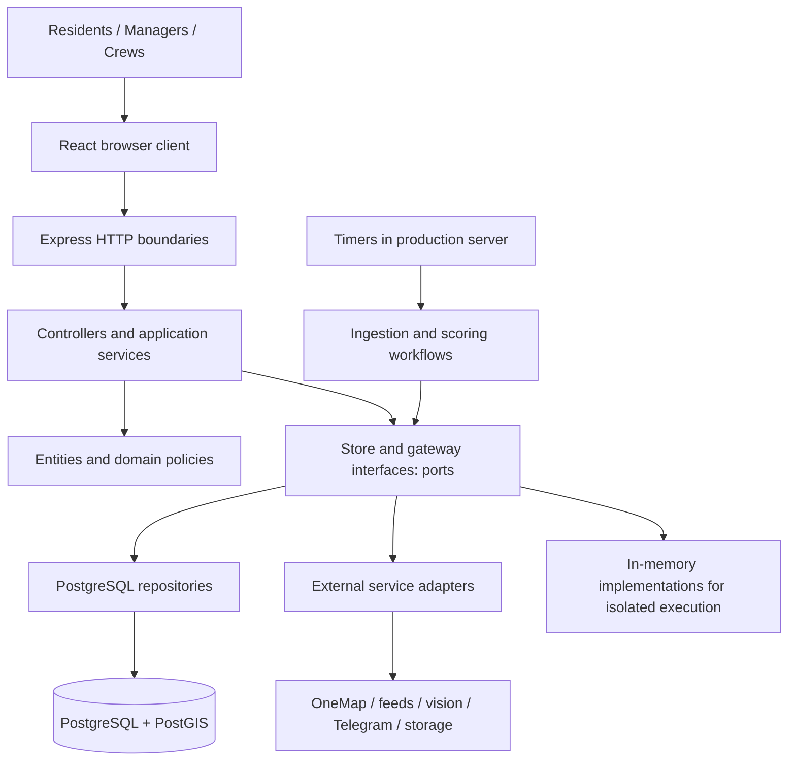
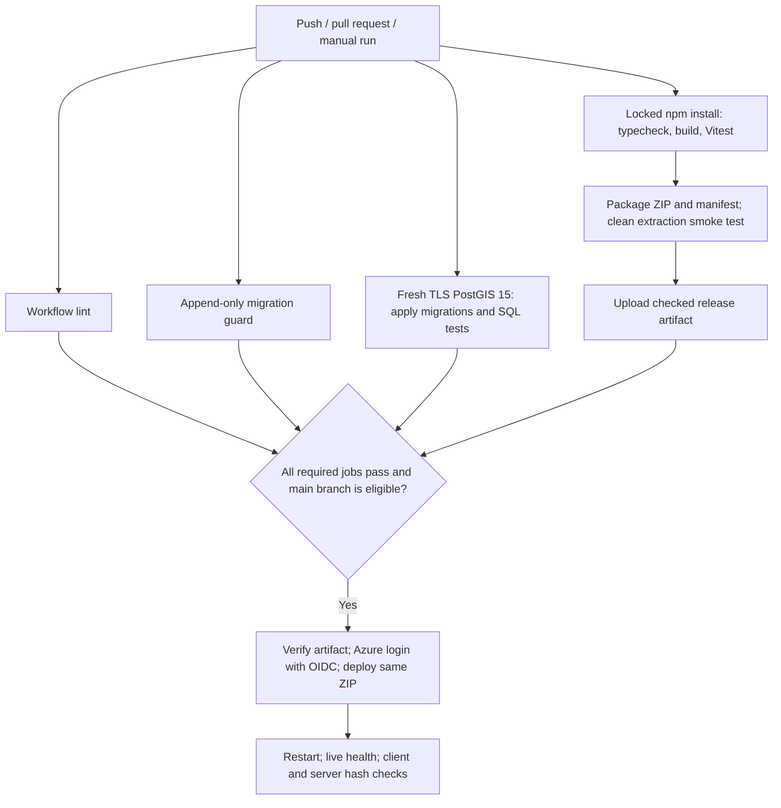

# D-Fence: introduction, engineering explanation, and UI demonstration

Prepared from the repository on 7 November 2026. Allow approximately 25 minutes, including clicks. Quoted paragraphs are ready to speak; action tables are presenter cues. Use the current screen values rather than memorised case counts or test totals.

This script reflects the current implementation. It does not certify the live deployment or report a new test run.

## Running order

| Time | Topic | Suggested presenter |
|---|---|---|
| 0:00–2:00 | Problem, purpose, users | 1 |
| 2:00–5:00 | Stack and architecture | 1 |
| 5:00–8:00 | Design patterns | 2 |
| 8:00–11:00 | Data flow, scoring, and dispatch | 2 |
| 11:00–20:00 | End-to-end UI demonstration | 3, with another presenter switching roles |
| 20:00–24:00 | Testing and CI/CD | 4 |
| 24:00–25:00 | Closing | 4 |

For one presenter, retain the same order. For a 20-minute slot, shorten the pattern discussion to Strategy, Template Method, and the lifecycle table; omit optional demo branches.

## 1. Introduce the problem and users

**Show:** landing page, followed by an operations overview screenshot or the prepared manager tab.

> “D-Fence is a system for turning pest information into coordinated field work in Singapore. It began with dengue prioritisation and now also supports reports about other pests.
>
> “Knowing that a problem exists is only the first step. Someone must decide how urgent it is, check the evidence, find an appropriate team and vehicle, plan a feasible journey, and confirm that the work was completed.
>
> “D-Fence connects these steps. Residents report what they see and follow their reports. Operations managers review evidence, inspect priorities, and organise dispatches. Field crews receive jobs, record their progress, and submit completion evidence.
>
> “We will follow one report through that process. Along the way, we will explain the technology and the design decisions that keep the workflow understandable and testable.”

**Explain the vocabulary before proceeding:** a *report* records an observation; a *priority score* estimates urgency for a locality and pest; a *work order* authorises a specific task; a *dispatch* groups assigned work with its team and logistics. These are related records with different responsibilities.

## 2. Explain the technology stack and architecture

**Show:** this stack table on a slide.

| Area | Technology in this repository | Purpose |
|---|---|---|
| Client | React 18, TypeScript, Tailwind CSS 4 | Role-specific screens and responsive styling |
| Maps | Leaflet, OneMap services | Geographic display, address lookup, and road routing |
| Server | Node.js, TypeScript, Express 4 | HTTP API, access checks, and application workflows |
| Build | esbuild, TypeScript compiler | Browser/server bundles and static type checks |
| Database | PostgreSQL with PostGIS, accessed through `pg` | Persistent records and geographic queries |
| Photos | Supabase Storage gateway | Store photo objects separately from relational records |
| Integrations | Public environmental/pest feeds, iNaturalist, OneMap, Gemini vision, Telegram | Evidence, routing, optional recognition, and notifications |
| Verification | Vitest, React Testing Library, Playwright, axe integration | Logic, component, browser, and accessibility checks |
| Delivery | GitHub Actions and Azure App Service | Automated checks, release packaging, and deployment |

> “TypeScript is used across the browser and server. React builds the interface, and Express exposes the API. PostgreSQL stores business records, while PostGIS adds geographic operations such as locating reports relative to cluster boundaries. Photographs go through a storage gateway rather than being embedded in database rows.
>
> “External services have specific jobs. OneMap supports mapping, address lookup, and road travel. Gemini can suggest pest information from photographs. Telegram can deliver notifications when configured. These services sit behind interfaces so their details do not spread through the application.”

**Show:** architecture diagram.



> “The application is a modular monolith: a single server application organised into clear modules. Its main separation follows Boundary, Control, and Entity, or BCE.
>
> “Boundaries receive HTTP requests or communicate with external providers. Controls coordinate use cases, such as reviewing a report or assigning a dispatch. Entities represent domain information such as reports, work orders, and completion evidence.
>
> “Ports are interfaces for storage and external capabilities. Repositories and gateways implement those interfaces. This resembles ports-and-adapters architecture: business workflows can be exercised with memory stores and test doubles, while production uses persistent services.
>
> “The browser also separates screen rendering, navigation, and API access. Role guards help users reach the correct screens, and server access checks enforce permissions for the actual operations.”

**Presenter accuracy note:** production composition is in `src/server.ts`. That file also starts background ingestion timers. The separate `src/scheduler.ts` still contains a scheduling TODO; do not describe it as a completed independent production worker. A modular monolith is an architectural description inferred from the source organisation, not a claim of microservices.

## 3. Highlight the important design patterns

**Introduce:**

> “The patterns matter because they solve recurring problems in this workflow. We will show the problem, the implementation, and the benefit of each.”

### Strategy and simple factories: interchangeable behaviour

**Show:** `src/control/routing/IRouteStrategy.ts`, `src/control/normalisation/NormalisationFactory.ts`, or a small class diagram.

> “Strategy gives interchangeable algorithms a common interface. For scoring, different drivers need different normalisation methods. Case counts and rainfall have different shapes, so the scoring engine can use logarithmic or capped-linear transformations through a shared contract.
>
> “Routing and pest recognition also have strategy interfaces. Factories select concrete implementations from configuration. This keeps selection decisions in one place and lets tests supply deterministic alternatives.”

**Clarify:** these are principally simple factories. Do not label every factory Abstract Factory. A direct-distance routing strategy exists, but its existence does not mean executable dispatch routes may bypass verified road-access requirements.

### Template Method: one reliable ingestion lifecycle

**Show:** `src/control/ingestion/AbstractIngestionJob.ts`.

> “Every feed follows a common lifecycle: record the start, decide whether a download is needed, fetch, validate, transform, persist, and record the outcome. The Template Method pattern puts that sequence in a base class, while each feed supplies its own parsing and storage steps.
>
> “This makes failure handling consistent. A failed download must not be interpreted as an empty world. The system retains previous usable data and records source health. An unchanged publication is also recorded, so ‘nothing changed’ is distinguishable from ‘the source failed’.”

### Observer: reactions to domain changes

**Show:** `src/control/observer/WorkOrderObserver.ts` and the report/cluster subjects.

> “Observer lets a domain event notify registered listeners. Work-order changes can trigger audit or notification behaviour without the publisher naming every response implementation. Typed subjects also exist for reports and cluster updates.
>
> “This is an in-process notification mechanism. It does not provide the durable delivery guarantees of a separate message broker.”

### Adapter and Repository: keep provider details at the edges

> “Adapters translate external protocols into the interfaces the application understands. Examples include OneMap, Telegram, and object storage gateways. Repositories do the equivalent for persistence: controllers request domain records through store contracts rather than constructing SQL in HTTP handlers.
>
> “These boundaries let most tests run without a production database or a paid provider.”

### Table-driven lifecycle: explicit permitted actions

**Show:** `src/control/WorkOrderTransitionTable.ts`.

> “The work-order lifecycle is defined as a transition table. Each rule specifies the starting state, destination state, permitted role, and conditions. Only the assigned crew can perform particular actions, and completion requires evidence.
>
> “The normal path is Created, Assigned, Accepted, In Progress, Completed, then Verified. Completed means the crew submitted its evidence. Verified means a manager accepted that evidence. A rejected completion can return for rework.
>
> “Keeping these rules together makes invalid transitions easier to reject and test.”

**Clarify:** this is a table-driven state machine, not an implementation using GoF State subclasses. The database wrapper is not a GoF Singleton. The facade exists, but production does not compose its entire graph through it. Composite is additionally implemented by `CompositeObservationJob` if asked.

## 4. Explain data flow, scoring, and planning

**Show:** three flows, one at a time.

```text
Public feeds → gateways → ingestion jobs → database
             → scoring → stored score history → API → dashboard

Resident form → upload/report API → validation and triage → report storage
              → review or applicable automatic verification → eligible task

Eligible tasks + staff + vehicles + road information → dispatch planner
              → manager assignment → crew work → evidence → manager verification
```

> “There are two main evidence inputs: external feeds and resident reports. External records are transformed and stored before they contribute to scoring. A resident report goes through server validation and triage, with review or automatic verification where policy permits. A photo suggestion is assistance; it is not proof that work has been done or a guarantee that the reported count is correct.
>
> “For locality-and-pest scoring, the model combines urgency with a configured severity multiplier. Its numerical form is 100 times severity times urgency. Urgency combines normalised drivers. Evidence tiers determine which driver set is appropriate. Mosquito scoring preserves the seven-driver dengue model.
>
> “The interface can show the inputs and contributions behind a score. Missing inputs can cause weight redistribution and a degraded-data indication rather than silently becoming zero. Critical override rules can raise a priority tier while retaining the numerical score and the reason for the override.
>
> “Report triage is a separate decision: it uses the specific report's pest, count, and hazard context. We should not confuse a report's triage label with a locality's numerical score.”

**Then explain planning:**

> “A high score does not make a task automatically feasible. The planner considers verified evidence, task identity, staff capabilities, headquarters, availability, suitable vehicles, cargo capacity, travel, and working time.
>
> “It uses priority-first greedy insertion followed by bounded local search. That means it adds tasks in priority order and tries a limited set of improvements. It seeks a useful feasible plan; it does not prove the globally shortest route.
>
> “Tasks that cannot be placed remain visible with a reason. Already committed work is distinguished from new allocations. A non-mosquito proposal requires a verified source report; a pest score alone does not create that dispatch task.
>
> “The manager reviews the proposal and commits an assignment. Crew progress and manager verification then feed back into operational records and later scoring cycles.”

**Do not promise:** immediate score reduction after a completion, a fixed drop in score, a route for every task, or an executable road route during a provider outage. Gravitrap areas are collected but are not an additional dengue scoring driver.

## 5. Demonstrate one complete UI journey

### Before presenting

- Prepare separate browser profiles for a resident, manager, and crew member. Use existing authorised demo accounts; keep passwords off slides.
- Rehearse on the exact deployment to be shown. Confirm health, data timestamps, maps, staff eligibility, vehicle availability, and route-provider readiness.
- Use a designated demo report and work order, with identifiable IDs. If creating one live, use a clearly labelled demonstration description and a unique location/time combination permitted by the duplicate rules.
- Prepare an illustrative photo and identify it as demonstration material. Do not present sample images as incident or treatment evidence.
- Ensure the chosen crew has the appropriate recorded capability, HQ, and availability. Schedule the demonstration job for today in Singapore time, or deliberately select its scheduled day.
- Keep screenshots of the same workflow for network failures. Explain when switching to recorded evidence. Avoid running cleanup, migrations, load tools, or live acceptance scripts during the presentation.

### A. Resident: observe and report — about 2 minutes

| Action | Say | What the audience should notice |
|---|---|---|
| Open `/`, then sign in as the resident. | “Residents have a focused view for local information, reports, and alerts.” | Role-specific navigation. |
| Open **Dengue map**, `/map`; select a cluster or report layer. | “The map relates observations to place. Data timestamps tell us how current the underlying information is.” | Boundaries, legend, timestamps; no memorised cluster counts. |
| Open **My locations** → **Add a location**, `/locations/new`; search for a prepared address and save it. | “A saved place gives the resident a repeatable way to check an area they care about.” | Address lookup and saved location. |
| Open **Report a site**, `/report`. Choose the relevant pest/report information, describe the demonstration, enter a valid location or use geolocation, and attach the prepared photo. | “A useful report needs context: what was seen, where it was seen, and supporting evidence.” | Count/context fields, upload state, and any validation. |
| If recognition is available, inspect its suggestions before applying them. | “Image recognition can assist entry. We inspect the suggestion rather than treating it as a confirmed observation.” | Suggestions remain visibly distinguishable from confirmed user input. |
| Submit and open the resulting report detail. Record its ID. | “The report now has an identity and status that the resident can follow.” | The actual status returned by the system. |

Do not guarantee that every new report remains Submitted: current policies include automatic verification paths. If it is already Verified, explain that result and continue with that same record.

### B. Manager: inspect evidence and priority — about 2 minutes

| Action | Say | What the audience should notice |
|---|---|---|
| Switch to manager; open `/ops`. | “The manager sees the wider workload and the data behind it.” | Operations overview and freshness. |
| Open a ranked cluster's detail, `/ops/clusters/:id`. Expand or inspect its score breakdown. | “This score is explainable: we can inspect the input, transformation, weight, and contribution.” | The distinction between score, priority tier, and evidence quality. |
| Open **Moderation**, `/ops/moderation`, and the recorded demo report if it requires review. Inspect the photo, location, and context, then verify it. If already verified, inspect its existing status/history. | “Reports become operational evidence through policy and review. We keep the actual report identity throughout.” | Evidence and accountable status changes. |
| Briefly open **Staff**, `/ops/staff`, and **Vehicles**, `/ops/vehicles`. | “A plan needs eligible people and suitable transport. These records constrain what we can assign.” | Capability, HQ, availability, and vehicle capacity. |

### C. Manager: plan and commit a dispatch — about 2 minutes

| Action | Say | What the audience should notice |
|---|---|---|
| Return to the operations dispatch workspace; `/ops/dispatch` is also a dedicated route. Select the prepared day. | “The dispatch workspace separates proposed work, planned routes, and work that is unassigned or already committed.” | **Routes**, **Unassigned / committed**, and **Proposals** tabs. |
| Inspect **Routes**; open a task and inspect the team's route, stops, and logistics. | “This task is connected to its source evidence and an eligible operational plan.” | Pest/task, priority, exact source location where available, team, vehicle, and cargo. |
| Change HQ or job-type filters; open a map callout. | “The map and task details support the same decision. These filters help a manager inspect a particular operational area.” | Matching cards and map tasks; reference photos labelled when used. |
| Open **Unassigned / committed** and read one available reason. | “An unassigned task remains visible. Its reason tells the manager what must change before it can be allocated.” | No promise that all urgent tasks can be routed. |
| Use the prepared proposal or work-order flow and assignment controls to save the demo dispatch with eligible crew and vehicle. Open `/ops/dispatches` to inspect the saved record. | “A proposed route becomes an operational commitment when the manager saves its assignment.” | Persisted assignment and its linked work order. |

Rehearse the exact assignment controls on the selected build. If the new report is unassigned, explain its reason and use the prepared eligible lifecycle order for the crew demonstration. State clearly that this is a second fixture. Do not imply that inspecting a proposal has assigned it.

### D. Crew and manager: close the loop — about 3 minutes

| Action | Say | What the audience should notice |
|---|---|---|
| Switch to the assigned crew; open **My jobs**, `/crew`. Select the correct day/filter and exact demo order. | “The crew sees assigned work rather than the manager's entire planning workspace.” | Same order ID, task, instructions, and assignment. |
| Open the job, `/crew/jobs/:id`; accept, then start it using the displayed controls. | “Accepting work and starting work are separate lifecycle events.” | Assigned → Accepted → In Progress. |
| Open completion, `/crew/jobs/:id/complete`. Point out the required photo and note; then attach labelled demonstration evidence and record the task performed. Submit. | “Completion requires evidence and a description. These conditions are enforced by the workflow.” | In Progress → Completed. |
| Switch back to manager; open `/ops/work-orders/:id`, inspect the evidence, then verify. | “The crew's completion is reviewed by a different role. Verification records the manager's acceptance.” | Completed → Verified; actor/time history. |
| Return to the resident's report and the manager overview. Explain the displayed linked status and refresh behaviour. | “The workflow leaves a trace from the original observation to the work and its review. Later scoring cycles can use the updated operational information.” | Actual linked state; no invented immediate score change. |

**Optional branches for questions:** show a rejection reason and rework path; open Analytics and discuss a data-sufficiency message; inspect Data sources; demonstrate alert settings if Telegram is configured; explain the referral route for cases requiring an authority. Contact numbers should be read from the current application, not recited from this script.

## 6. Explain testing and CI/CD

**Transition:**

> “We have shown the successful journey. Engineering checks must also cover the situations where the system should refuse, degrade gracefully, or preserve existing data.”

### Testing layers

| Layer | Examples in the repository | What it establishes |
|---|---|---|
| Domain and service tests | Scoring goldens, normalisation, triage, transition guards, routing invariants | Rules, boundaries, and failure behaviour with controlled inputs |
| Component tests | Report forms, dispatch assignment, map and role screens | Rendering and user interaction with controlled API responses |
| HTTP tests | HTTP boundary, privacy, account and access tests | API behaviour and permission boundaries |
| SQL integration tests | `tests/repository.test.ts` | Real persistence and geographic behaviour against a database |
| Release smoke test | `tools/smoke-release.mjs` | A fresh extracted production package can boot and serve key paths |
| Browser checks | `tests-ui/ui-sweep.pw.ts`, Playwright configuration | Browser interaction and accessibility checks on an isolated local server |
| Targeted rehearsal/load tools | `uat`, `uat:client`, `load:check`, documented demo runners | Additional checks whose claims depend on their actual environment and results |

> “Vitest checks the rules and components. We test boundary cases such as missing completion evidence, invalid transitions, duplicate reports, task uniqueness, and infeasible routes—not only successful actions.
>
> “Real SQL tests run separately against disposable PostGIS. This matters because a memory store cannot prove that migrations, constraints, SQL mappings, or geographic queries work.
>
> “Browser tests check how the screens behave in an actual browser. The Playwright configuration launches an isolated local application using memory stores and blank service credentials. These browser checks are available separately; the current deployment workflow does not run `npm run ui:check`.
>
> “The clean-package smoke test covers another risk: source tests can pass while the release package is missing a runtime file. It extracts the package, blocks outbound HTTP, and checks boot, health, manager sign-in, routing, and the browser shell. That does not prove live provider or production database connectivity.”

### The delivery pipeline

**Show:** `.github/workflows/deploy.yml` or this diagram.



> “CI runs on pushes, pull requests, and manual requests. Four checks gate production: workflow linting, an append-only migration guard, a fresh-database migration and SQL test job, and a test-and-package job.
>
> “The package job installs the locked dependencies, checks TypeScript, builds the application, and runs tests without production services. It then creates and smoke-tests the release ZIP. The SQL job applies all migrations to a fresh TLS-enabled PostGIS 15 database and explicitly runs the repository tests there.
>
> “Only an eligible main-branch run deploys. The deployment downloads the exact checked artifact and verifies its hash and inventory. It does not rebuild from a branch that may have moved.
>
> “Azure login uses GitHub OpenID Connect, which provides short-lived identity rather than a stored deployment password. Runtime provider and database credentials remain in Azure configuration. Production deployments run one at a time.
>
> “After deployment, the workflow restarts the application, waits for health, and checks the served client and deployed server against the tested build. A successful upload alone is insufficient.”

**State this operational limit explicitly:**

> “The workflow validates migrations against a disposable database, but it does not apply production migrations. New production schema changes need a separate controlled migration step. The checks also do not establish automatic rollback or zero-downtime deployment.”

## 7. Close

> “D-Fence connects observation, prioritisation, planning, execution, and review. Residents provide local evidence, managers make informed assignments, and crews return evidence of completed work.
>
> “The architecture separates business rules from screens, databases, and providers. The design patterns make algorithms replaceable and workflows consistent. Tests check rules and persistence, while the delivery pipeline verifies the package that reaches the host.
>
> “The result is an accountable operational workflow: we can explain why work is urgent, why a team can handle it, and who verified the result.”

## Presenter reference: implementation anchors

| Claim | Source to open if asked |
|---|---|
| Stack and commands | `package.json`, `client/build.mjs`, `tools/build-server.mjs` |
| Production composition and scheduling | `src/server.ts` |
| UI URLs and permitted roles | `client/src/app/routes.ts` |
| Server access policy | `src/control/AccessControlService.ts`, `src/control/AccessPolicy.ts` |
| Lifecycle guards | `src/control/WorkOrderTransitionTable.ts`, `src/control/WorkOrderLifecycleController.ts` |
| Report triage and lifecycle | `src/control/ReportTriagePolicy.ts`, `src/control/ReportLifecycleController.ts` |
| Priority calculation | `src/control/scoring/PestPriorityCalculator.ts`, `src/control/scoring/UrgencyCalculator.ts` |
| Routing algorithm and constraints | `docs/ROUTING-ALGORITHM-STE100.md`, `src/control/RouteOptimizationService.ts` |
| Planning and persisted assignments | `src/control/DispatchPlanService.ts`, `src/control/DispatchAssignmentService.ts`, `src/persistence/DispatchAssignmentUnit.ts` |
| Pattern evidence and limitations | `DESIGN-PATTERNS.md` |
| Actual CI gates and deployment | `.github/workflows/deploy.yml` |
| Separate browser check configuration | `playwright.config.ts`, `tests-ui/ui-sweep.pw.ts` |
| Recent dispatch demonstration contracts | `docs/demo-dispatch-flows.md` |

When older demo or CI prose conflicts with the current source, use the current source. In particular, older material describes SQL integration tests as entirely skipped in CI; the current workflow has a separate disposable-database job that runs them.
