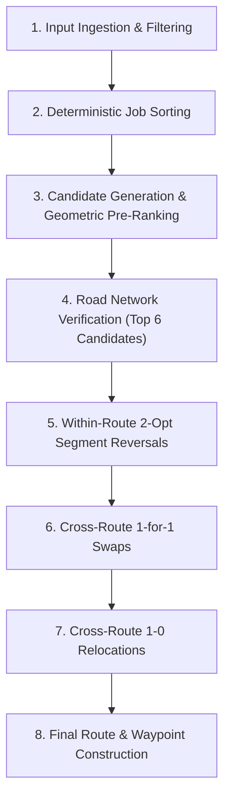

# D-Fence Dispatch Route Planning Algorithm

**Source code references:**
- [`RouteOptimizationService.ts`](file:///C:/Users/chowy/alfred/smart_nation/dengue/src/control/RouteOptimizationService.ts)
- [`DispatchRouteInputs.ts`](file:///C:/Users/chowy/alfred/smart_nation/dengue/src/control/DispatchRouteInputs.ts)
- [`IRouteStrategy.ts`](file:///C:/Users/chowy/alfred/smart_nation/dengue/src/control/routing/IRouteStrategy.ts)
- [`OneMapRoadRoutingStrategy.ts`](file:///C:/Users/chowy/alfred/smart_nation/dengue/src/control/routing/OneMapRoadRoutingStrategy.ts)
- [`RouteStrategyFactory.ts`](file:///C:/Users/chowy/alfred/smart_nation/dengue/src/control/routing/RouteStrategyFactory.ts)
- [`LogisticsPolicy.ts`](file:///C:/Users/chowy/alfred/smart_nation/dengue/src/control/LogisticsPolicy.ts)

---

## 1. Pipeline

The routing pipeline executes eight sequential steps to construct and refine daily team routes.



### Step 1: Input Ingestion and Capacity Filtering
- **What it does:** Sanitises crew pools, available fleet vehicles, and pending tasks. Excludes committed work orders (`Assigned`, `Accepted`, `InProgress`, `Rejected`). Maps default effort minutes, staff requirements, and priority tiers.
- **Input:** `RouteTeam[]`, `RouteJob[]`, `Vehicle[]`, committed status sets.
- **Output:** Validated `pools` (available/on-call staff), `fleet` (available vehicles with valid dimensions and payload), and `pending` (unallocated eligible jobs).
- **Function:** [`RouteOptimizationService.plan`](file:///C:/Users/chowy/alfred/smart_nation/dengue/src/control/RouteOptimizationService.ts#L197-L245).
- **Constants:**
  - Default effort minutes: WildBoar = 75 min; Snake/Crocodile = 60 min; MonitorLizard = 55 min; Fogging = 45 min; Larviciding/RefuseClearance = 40 min; DrainClearance = 50 min; Inspection = 30 min; fallback = 35 min ([`estimateEffortMinutes`](file:///C:/Users/chowy/alfred/smart_nation/dengue/src/control/RouteOptimizationService.ts#L138-L149)).
  - Default staff requirement: WildBoar/Crocodile = 4 staff; Snake/MonitorLizard = 2 staff; Fogging = 3 staff; Larviciding/DrainClearance/RefuseClearance = 2 staff; fallback = 1 staff ([`estimateRequiredStaff`](file:///C:/Users/chowy/alfred/smart_nation/dengue/src/control/RouteOptimizationService.ts#L117-L123)).
  - CPU/Road planning deadline: `roadDeadline = Math.min(Date.now() + 30_000, options.deadline)` ([line 198](file:///C:/Users/chowy/alfred/smart_nation/dengue/src/control/RouteOptimizationService.ts#L198)).
  - Provider evaluation budget: `maxProviderCalls = Math.max(160, jobs.length * 6 + 200)` ([line 202](file:///C:/Users/chowy/alfred/smart_nation/dengue/src/control/RouteOptimizationService.ts#L202)).
  - Search step budget: `maxSearchSteps = 100_000` ([line 204](file:///C:/Users/chowy/alfred/smart_nation/dengue/src/control/RouteOptimizationService.ts#L204)).

### Step 2: Deterministic Pending Job Sorting
- **What it does:** Sorts the `pending` queue before insertion so that urgent, scarce, and quick tasks take precedence.
- **Input:** Unordered `pending: RouteJob[]`.
- **Output:** Deterministically sorted `pending: RouteJob[]`.
- **Function:** [`RouteOptimizationService.plan`](file:///C:/Users/chowy/alfred/smart_nation/dengue/src/control/RouteOptimizationService.ts#L248-L251).
- **Sorting hierarchy:**
  1. Priority tier descending: Critical (weight 4) > High (weight 3) > Medium (weight 2) > Low (weight 1).
  2. Capability scarcity ascending: `pools.filter(t => capable(t, a)).length - pools.filter(t => capable(t, b)).length` (tasks compatible with fewer teams are placed first).
  3. Total person-effort ascending: `a.estimatedEffortMinutes * a.requiredStaff - b.estimatedEffortMinutes * b.requiredStaff` (shorter tasks clear first to increase throughput).
  4. Priority score descending: `(b.score ?? 0) - (a.score ?? 0)` (tie-breaker).

### Step 3: Candidate Generation and Geometric Pre-Ranking
- **What it does:** Takes the first pending job. Checks every capable crew pool and every feasible route insertion position. Checks hard constraints: crew availability, vehicle seat capacity, payload, volumetric cargo, dimensional packing fit, stop limits, and priority monotonicity. Ranks valid candidate insertions by incremental straight-line transit time.
- **Input:** Target `RouteJob`, active `assignments: CrewAssignment[]`, available `pools`, and `fleet`.
- **Output:** Array of feasible `candidates`, capped at 5,000, sorted ascending by geometric cost delta.
- **Function:** [`RouteOptimizationService.plan`](file:///C:/Users/chowy/alfred/smart_nation/dengue/src/control/RouteOptimizationService.ts#L254-L307).
- **Constants:**
  - Shift duration limit: `MAX_DISPATCH_SECONDS = 14_400 s` (4 hours) ([line 114](file:///C:/Users/chowy/alfred/smart_nation/dengue/src/control/RouteOptimizationService.ts#L114)).
  - Urban transit model: 35 km/h ≈ 9.72 m/s; minimum leg floor = 180 s (3 minutes) for legs $\ge$ 10 m ([lines 176-181](file:///C:/Users/chowy/alfred/smart_nation/dengue/src/control/RouteOptimizationService.ts#L176-L181)).
  - Maximum generated candidates: `5_000` ([line 263](file:///C:/Users/chowy/alfred/smart_nation/dengue/src/control/RouteOptimizationService.ts#L263)).

### Step 4: Road Network Verification (Top 6 Candidates)
- **What it does:** Tests up to 6 top-ranked candidates against the road network using OneMap driving and walking directions. Enforces the strict 4-hour shift cap. Selects the candidate that yields the smallest increase in verified road duration. Commits the assignment and restarts candidate generation at index 0.
- **Input:** Top 6 candidates from Step 3.
- **Output:** Selected candidate committed to `assignments`; assigned job removed from `pending`.
- **Function:** [`RouteOptimizationService.plan`](file:///C:/Users/chowy/alfred/smart_nation/dengue/src/control/RouteOptimizationService.ts#L308-L372).
- **Constants:**
  - Maximum evaluated candidates per task: `6` ([line 311](file:///C:/Users/chowy/alfred/smart_nation/dengue/src/control/RouteOptimizationService.ts#L311)).
  - Per-candidate timeout: `perCandidateWaitMs = 5_000 ms`, shortened dynamically when an acceptable candidate is already selected ([lines 329-334](file:///C:/Users/chowy/alfred/smart_nation/dengue/src/control/RouteOptimizationService.ts#L329-L334)).
  - Max pedestrian walking duration: 600 s (10 minutes) per leg ([`OneMapRoadRoutingStrategy.ts`](file:///C:/Users/chowy/alfred/smart_nation/dengue/src/control/routing/OneMapRoadRoutingStrategy.ts#L85)).
  - Maximum road snap distance: 25 m for tasks; 250 m (`MAX_ROAD_SNAP_METRES`) for HQ depots ([`IRouteStrategy.ts`](file:///C:/Users/chowy/alfred/smart_nation/dengue/src/control/routing/IRouteStrategy.ts#L97)).

### Step 5: Within-Route 2-Opt Optimization
- **What it does:** Reverses contiguous subsegments of stops within an individual route if all stops in that segment share the same priority tier. Verifies reversed routes via OneMap. Accepts the reversal if verified road duration decreases.
- **Input:** Built `assignments`.
- **Output:** Internally reordered stops for qualifying routes.
- **Function:** [`RouteOptimizationService.improveAcrossRoutes`](file:///C:/Users/chowy/alfred/smart_nation/dengue/src/control/RouteOptimizationService.ts#L424-L437).
- **Constants:**
  - Maximum within-route checks: `maxWithinRouteChecks = 64` ([line 397](file:///C:/Users/chowy/alfred/smart_nation/dengue/src/control/RouteOptimizationService.ts#L397)).

### Step 6: Cross-Route 1-for-1 Swaps
- **What it does:** Evaluates swapping one task from route A with one task from route B. Requires identical priority tiers. Validates crew capability, staff capacity, and vehicle cargo feasibility on both routes. Verifies both routes concurrently via OneMap. Accepts the swap if the combined verified road duration decreases.
- **Input:** Pairwise routes $(a, b)$.
- **Output:** Swapped tasks across assignments; terminates immediately upon the first accepted improvement.
- **Function:** [`RouteOptimizationService.improveAcrossRoutes`](file:///C:/Users/chowy/alfred/smart_nation/dengue/src/control/RouteOptimizationService.ts#L438-L454).
- **Constants:**
  - Maximum cross-route checks: `maxCrossRouteChecks = 136` (shared with Step 7) ([line 398](file:///C:/Users/chowy/alfred/smart_nation/dengue/src/control/RouteOptimizationService.ts#L398)).

### Step 7: Cross-Route 1-0 Relocations (Moves)
- **What it does:** Evaluates moving a task from route A to route B without a return swap. Ensures route A is not left empty. Validates crew capability, staff count, vehicle cargo, and priority order on route B. Accepts the move if the combined verified road duration decreases.
- **Input:** Pairwise routes $(a, b)$ and $(b, a)$.
- **Output:** Shifted task; terminates immediately upon the first accepted improvement.
- **Function:** [`RouteOptimizationService.improveAcrossRoutes`](file:///C:/Users/chowy/alfred/smart_nation/dengue/src/control/RouteOptimizationService.ts#L456-L476).
- **Constants:**
  - Shares the `maxCrossRouteChecks = 136` budget.

### Step 8: Final Route and Waypoint Construction
- **What it does:** Transforms internal assignments into immutable presentation structures. Inserts depot departure and arrival waypoints, intermediate specimen quarantine returns (with 20 min handling), cumulative timestamps, vehicle packing lists, and cargo load percentages.
- **Input:** Final `CrewAssignment[]`.
- **Output:** `PlannedTeamRoute[]`.
- **Function:** [`RouteOptimizationService.buildRoute`](file:///C:/Users/chowy/alfred/smart_nation/dengue/src/control/RouteOptimizationService.ts#L523-L600).
- **Constants:**
  - Intermediate base return effort: 1,200 s (20 minutes) handling time ([line 565](file:///C:/Users/chowy/alfred/smart_nation/dengue/src/control/RouteOptimizationService.ts#L565)).
  - Standard team route palette: 8 high-contrast colours ([`TEAM_COLORS`](file:///C:/Users/chowy/alfred/smart_nation/dengue/src/control/RouteOptimizationService.ts#L126-L135)).

---

## 2. Greedy Insertion

### Stop and Insertion Position Selection
The planner processes pending jobs sequentially from the sorted queue. For a given job, the algorithm iterates over:
1. Every compatible pool (`capable(pool, job)`).
2. Every existing assignment for that pool, plus an empty assignment representing a new route.
3. Every valid insertion index `pos` from `0` to `current.length`.

### Hard Priority Monotonicity Rule
The algorithm enforces strict priority monotonicity across stops in every route. Priority is a structural constraint, not a soft penalty term:
```typescript
// RouteOptimizationService.ts lines 280-281
if (pos > 0 && getPriorityWeight(current[pos - 1]!.priority) < weight) continue;
if (pos < current.length && getPriorityWeight(current[pos]!.priority) > weight) continue;
```
A task can never be inserted after a task of lower priority, nor before a task of higher priority.

### Resource Feasibility Checks
Before any distance calculation, the candidate insertion must pass five hard gates:
1. **Staff availability:** `addedHeads <= free` in the depot pool.
2. **Stop limit:** `current.length < pool.maxStops`.
3. **Shift duration pre-check:** Estimated service effort + on-call lag $\le$ 14,400 s (4 hours).
4. **Fleet reservation:** An available vehicle from the team's depot (`vehicle.hqLocation === pool.teamId.split('-')[0]`) must satisfy:
   - `vehicle.seatCapacity >= size`
   - `load.weightKg <= vehicle.maxPayloadKg`
   - `load.volumeM3 <= vehicle.maxCargoVolumeM3`
   - `packing.every(item => itemFitsCargo(item, vehicle))` (3D bounding-box orientation check).

### Geometric Cost Formula
For candidate positions that pass feasibility, the algorithm computes straight-line transit time:
```typescript
// RouteOptimizationService.ts lines 176-181, 296-303
function estimateTransitSeconds(from: GeoPoint, to: GeoPoint): number {
  const dist = from.distanceTo(to); // Haversine distance in metres
  if (dist < 10) return 0;
  // 35 km/h ≈ 9.72 m/s; minimum 180s (3 minutes) for any separate road leg
  return Math.max(180, Math.round(dist / 9.72));
}

const stops = this.stops(pool.hq, routeJobs);
const travel = stops.slice(1).reduce((sum, point, i) => sum + estimateTransitSeconds(stops[i]!, point), 0);
const oldStops = existing ? this.stops(pool.hq, existing.jobs) : [];
const oldEstimate = oldStops.slice(1).reduce((sum, point, i) => sum + estimateTransitSeconds(oldStops[i]!, point), 0);

candidates.push({ pool, existing, jobs: routeJobs, size, addedHeads, vehicle, cost: travel - oldEstimate });
```
- **Cost metric:** `cost = travel - oldEstimate`.
- For an existing route, `cost` is the marginal increase in estimated round-trip transit time.
- For a new route, `oldEstimate = 0`, so `cost` is the entire circuit's estimated transit time.
- All valid candidates are sorted ascending by geometric cost: `candidates.sort((a, b) => a.cost - b.cost)`.

---

## 3. Road Check

### When OneMap is Called
The planner calls OneMap immediately after ranking candidates by geometric cost. It does not query OneMap for all generated candidates. It evaluates only the top candidates from the sorted candidate list.

### Candidate Limit and Concurrency
- **Candidate count:** At most **6 candidates** are evaluated per job (`evaluated >= 6`, [line 311](file:///C:/Users/chowy/alfred/smart_nation/dengue/src/control/RouteOptimizationService.ts#L311)).
- **Leg concurrency:** OneMap requests are throttled to **4 concurrent leg calls** per strategy instance (`acquireLegRequest`, [`OneMapRoadRoutingStrategy.ts`](file:///C:/Users/chowy/alfred/smart_nation/dengue/src/control/routing/OneMapRoadRoutingStrategy.ts#L24-L42)).
- **Leg caching:** Verified road legs are cached in-memory with a 5-minute TTL (`expiresAt: Date.now() + 5 * 60_000`, max 512 entries).

### Pedestrian Walking Leg Verification
When OneMap returns a driving route whose access point is more than 25 metres from the target location (and the site is not within an approved polygon service area):
- The strategy requests two pedestrian walking routes: outbound (`accessPoint -> targetPoint`) and return (`targetPoint -> accessPoint`).
- Each walking leg must take $\le$ 600 seconds (10 minutes) and end within 25 metres of target coordinates.
- Driving duration and walking duration are summed into total travel time:
  $$\text{durationSeconds} = \text{drivingDurationSeconds} + \text{walkingDurationSeconds}$$

### Failure and Timeout Handling
Each candidate evaluation runs inside a strict timeout harness:
```typescript
// RouteOptimizationService.ts lines 326-335
route = await Promise.race([
  this.strategy.calculateRoute(stops, controller.signal, serviceAreas, depotStopIndices),
  new Promise<never>((_resolve, reject) => {
    const optionalWait = selected !== undefined
      ? remaining / Math.max(1, pending.length) / Math.max(1, 6 - evaluated)
      : this.perCandidateWaitMs;
    timer = setTimeout(() => { controller.abort(); reject(new Error('Road verification wait budget exhausted')); },
      Math.min(remaining, this.perCandidateWaitMs, optionalWait));
  }),
]);
```
- **Timeout budget:** `perCandidateWaitMs = 5_000 ms`. If an acceptable candidate is already found (`selected !== undefined`), the timeout shrinks to `optionalWait` to conserve search time.
- **On error or timeout:** The catch block catches the error and assigns `route = null`. The candidate is discarded (`if (!plan) continue;`).
- **Exceeding shift limit:** If `plan.durationSeconds + effort + lag > 14_400 s`, the candidate is rejected.
- **Best candidate selection:** The planner tracks the verified candidate with the lowest incremental road duration:
  $$\Delta_{\text{road}} = \text{plan.durationSeconds} - \text{candidate.existing.plan.durationSeconds}$$
  If no candidate verifies, the job remains unassigned and is marked in `roadUnverified`.

---

## 4. 2-Opt Optimization

### Plain-English Definition
The 2-opt algorithm is a local search tour-improvement method. It takes a route, cuts two non-adjacent road connections, and reconnects the route by reversing the order of all stops in between. If the reversed sequence produces a shorter total travel time, the algorithm keeps the reversed segment. It repeats this test across different stop pairs until no further reversal reduces travel time.

### 5-Stop Worked Example
Consider a field crew departing Central Depot ($D$), visiting 5 dengue inspection stops ($S_1, S_2, S_3, S_4, S_5$), and returning to $D$. All 5 stops share Medium priority.

```
Initial order:  D -> S1 -> S2 -> S3 -> S4 -> S5 -> D
Crossed path:   The leg S2 -> S3 crosses over the path of S4 -> S5 due to sequential insertion order.
```

#### Step-by-step travel times (seconds):
- $D \to S_1$: 400 s
- $S_1 \to S_2$: 350 s
- $S_2 \to S_3$: 900 s *(crossing leg)*
- $S_3 \to S_4$: 300 s
- $S_4 \to S_5$: 850 s *(crossing leg)*
- $S_5 \to D$: 500 s
- **Total Initial Duration:** $400 + 350 + 900 + 300 + 850 + 500 = \mathbf{3,300\text{ s}}$ (55.0 min).

#### Applying 2-opt reversal between index 2 ($S_2$) and index 4 ($S_4$):
The intermediate subsegment $[S_2, S_3, S_4]$ is reversed to $[S_4, S_3, S_2]$.
```
Reversed order: D -> S1 -> S4 -> S3 -> S2 -> S5 -> D
```
New travel times on untangled road segments:
- $D \to S_1$: 400 s *(unchanged)*
- $S_1 \to S_4$: 320 s *(replaces S1 -> S2)*
- $S_4 \to S_3$: 310 s *(directed road leg)*
- $S_3 \to S_2$: 330 s *(directed road leg)*
- $S_2 \to S_5$: 360 s *(replaces S4 -> S5)*
- $S_5 \to D$: 500 s *(unchanged)*
- **New Duration:** $400 + 320 + 310 + 330 + 360 + 500 = \mathbf{2,220\text{ s}}$ (37.0 min).
- **Net Saving:** $3,300 - 2,220 = \mathbf{1,080\text{ s}}$ (18.0 minutes saved).
- Because $2,220\text{ s} + 10^{-6} < 3,300\text{ s}$, the algorithm accepts the reversed order.

### Application in the Codebase
The codebase implements 2-opt in [`RouteOptimizationService.improveAcrossRoutes`](file:///C:/Users/chowy/alfred/smart_nation/dengue/src/control/RouteOptimizationService.ts#L424-L437):
1. **Scope:** Applied **within each individual route**. It iterates over all subsegment start indices `start` and end indices `end`.
2. **Priority Monotonicity Constraint:**
   ```typescript
   // Line 428
   if (assignment.jobs.slice(start, end + 1).some((job) => getPriorityWeight(job.priority) !== getPriorityWeight(assignment.jobs[start]!.priority))) break;
   ```
   A segment is reversed **only if every stop in that slice belongs to the exact same priority tier**. Reversing across priority boundaries is forbidden.
3. **Cost Metric:** Compares verified road duration via OneMap (`plan.durationSeconds`), **not** straight-line distance:
   ```typescript
   // Line 432
   if (plan && feasible(assignment, jobs) && plan.durationSeconds + this.effort(jobs) + this.lag(assignment.pool) <= MAX_DISPATCH_SECONDS &&
     plan.durationSeconds + 1e-6 < assignment.plan.durationSeconds) {
     assignment.jobs = jobs; assignment.plan = plan;
     break;
   }
   ```
4. **Termination:**
   - Breaks immediately upon finding the first improving reversal for that route ([line 434](file:///C:/Users/chowy/alfred/smart_nation/dengue/src/control/RouteOptimizationService.ts#L434)).
   - Hard execution ceiling: `withinRouteChecks >= maxWithinRouteChecks` (64 checks).
   - Aborts if `Date.now() >= cpuDeadline` or `Date.now() >= roadDeadline`.

---

## 5. Cross-Route Improvement

Function [`improveAcrossRoutes`](file:///C:/Users/chowy/alfred/smart_nation/dengue/src/control/RouteOptimizationService.ts#L391-L478) performs two cross-crew optimization routines after within-route 2-opt completes:

### 1. Pairwise 1-for-1 Swaps (Lines 438-454)
- Iterates over route pairs $(a, b)$ with $left < right$.
- Tests swapping task $a_i$ from crew $a$ with task $b_j$ from crew $b$.
- **Constraints:**
  - Tasks must have identical priority weight: `getPriorityWeight(aj.priority) === getPriorityWeight(bj.priority)`.
  - Both crews must have the capabilities required for their new tasks.
  - Both routes must satisfy vehicle passenger capacity, payload weight, cargo volume, and packing dimensions.
  - Both routes must remain $\le$ 14,400 s (4 hours).
- **Verification:** Both routes are verified concurrently via OneMap:
  ```typescript
  const [aPlan, bPlan] = await Promise.all([verify(a, aJobs), verify(b, bJobs)]);
  ```
- **Acceptance:** Accepted if the combined road duration strictly decreases:
  $$aPlan.\text{durationSeconds} + bPlan.\text{durationSeconds} + 10^{-6} < a.\text{plan}.\text{durationSeconds} + b.\text{plan}.\text{durationSeconds}$$
- **Termination:** Terminating immediately (`return`) on the first accepted swap.

### 2. Cross-Route 1-0 Relocations / Moves (Lines 456-476)
- If no swap succeeded, tests transferring a single task from a source route to a target route ($a \to b$ and $b \to a$).
- **Constraints:**
  - Target crew must possess required capabilities and sufficient staff count.
  - Source route cannot become empty (`if (!sourceJobs.length) continue;`).
  - Target vehicle must fit the additional cargo load.
  - Evaluates all possible insertion positions `pos` in the target route.
- **Verification:** Both modified routes are verified via OneMap.
- **Acceptance:** Accepted if total combined road duration strictly decreases.
- **Termination:** Terminating immediately (`return`) on the first accepted move.
- **Shared Budget:** Swaps and relocations share a maximum limit of `maxCrossRouteChecks = 136`.

---

## 6. Slide Text Draft

### 6-Step Process Flow (Maximum 8 words per step)
1. **Sort jobs by priority, capability, and effort** *(8 words)*
2. **Filter crew skills, vehicle cargo, shift caps** *(7 words)*
3. **Rank insertion points with straight-line transit time** *(7 words)*
4. **Verify top six candidates through OneMap API** *(7 words)*
5. **Reverse equal-priority segments via 2-opt local search** *(7 words)*
6. **Swap or move jobs across crew routes** *(7 words)*

### 3 Key Takeaways (Bullet Points)
- **Hard operational boundaries:** Every route enforces depot affinity, vehicle seat and cargo dimensions, and a strict 4-hour total shift ceiling.
- **Verified multimodal access:** Tasks outside a 25-metre vehicle road snap require verified pedestrian walking paths under 10 minutes.
- **Priority-safe local search:** 2-opt reversals and cross-crew swaps operate strictly within identical priority tiers to preserve critical response speed.

### Speaker Notes (Exactly 80 words)
D-Fence automates dispatch through priority-first greedy insertion and bounded local search. The server first sorts pending jobs by urgency, capability rarity, and work duration. For each task, it filters feasible crew and vehicle combinations, ranking insertion positions by straight-line travel estimates. It checks up to six candidate routes against OneMap driving and walking directions under a strict four-hour shift limit. Finally, bounded 2-opt reversals and cross-crew swaps optimise total travel time without compromising priority order or vehicle cargo carrying capacity.

---

## 7. Comparison with User Summary

| Summary Element | Code Reality | Status | Specific Differences & Nuances |
|---|---|---|---|
| **Greedy insertion** | Greedy priority-first insertion loop (`RouteOptimizationService.ts:254-372`) | **CONFIRMED** | Pending tasks are ordered by a 4-tier sort (priority, capability rarity, person-effort ascending, score) before greedy insertion begins. The loop resets to index 0 after every allocation. |
| **Straight-line distances first** | Geometric transit time estimation (`RouteOptimizationService.ts:176-181, 296-303`) | **CLARIFIED** | The metric is not raw Euclidean distance. It is **estimated transit seconds** derived from Haversine distance at 35 km/h (~9.72 m/s) with a 180 s minimum floor per leg $\ge$ 10 m. Candidate generation is constrained by priority monotonicity, crew availability, and 3D cargo packing before ranking. |
| **OneMap road times for 6 candidates** | Up to 6 candidates evaluated via road strategy (`RouteOptimizationService.ts:310-350`) | **CONFIRMED WITH EXTENSIONS** | Exactly up to 6 candidates are checked. However, OneMap evaluates **both driving and pedestrian walking legs** (for stops > 25 m from roads, up to 10 min walk). Requests use a 4-connection concurrency pool and 5-second per-candidate timeouts. Discards invalid routes on timeout or failure. |
| **2-opt improvement** | Within-route 2-opt + Cross-route swaps & moves (`RouteOptimizationService.ts:391-478`) | **EXTENDED / CORRECTED** | 2-opt is **not the only improvement step**: <br>1. Within-route 2-opt reversals are strictly restricted to **equal-priority segments** (max 64 checks). <br>2. Crucially, the algorithm also executes **cross-route 1-for-1 swaps** and **cross-route 1-0 relocations** across different crews (max 136 checks). <br>3. All improvement steps compare **OneMap verified road duration**, not straight-line distance. |

*All statements verified against application source code at commit `29ffe20` / `edf3e4de15`. No UNCONFIRMED items.*
